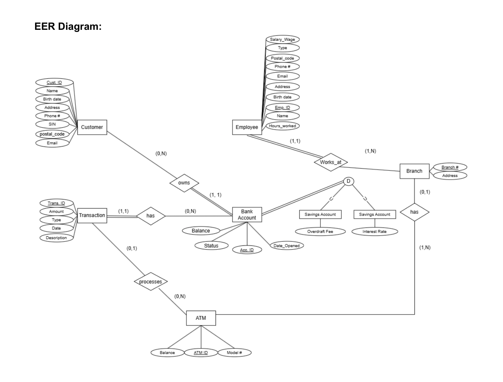

# Retail Banking Database System

A group database project developed for **CPS 510 at Toronto Metropolitan University**, using **Oracle SQL, SQL*Plus, and Unix shell scripting**.

## Purpose of the Project

The goal of this project was to design and implement a relational database that represents the information a retail bank needs to manage.

Rather than storing customer, account, employee, and transaction information in disconnected records, we designed related tables so banking data could be organized consistently and retrieved through SQL.

The project demonstrates the progression from **database design to implementation, data analysis, and command-line interaction**.

This is an educational project using sample banking records, not a production banking application.

## What the System Models

The database represents:

- Customers
- Bank branches
- Bank accounts
- Savings and chequing account details
- Employees
- ATMs
- Banking transactions

These entities are connected using **primary keys and foreign keys** to represent relationships such as a customer owning an account, an employee working at a branch, or a transaction involving an account and possibly an ATM.

The schema consists of eight tables:

`branch`, `customer`, `accounts`, `savings_accounts`, `chequing_accounts`, `employee`, `atm`, and `transaction`.

## Database Design (EER Diagram)

We created an Enhanced Entity–Relationship (EER) diagram to plan the database structure and identify relationships between banking entities before implementing the tables in Oracle SQL.



## Why We Wrote Each Part of the Code

### 1. Database Design and Table Creation

We first designed an Enhanced Entity–Relationship (EER) diagram to identify the banking entities, their attributes, and how they relate to each other. We then translated that design into Oracle SQL `CREATE TABLE` statements.

**Purpose:** To build the database structure and use constraints such as primary keys, foreign keys, and required fields to help maintain consistent records.

**Files:**
- `EER-Diagram.png`
- `01_schema.sql`

### 2. Sample Data and Simple Queries

We inserted sample records into the banking tables and wrote introductory SQL queries to retrieve and filter information from them.

**Purpose:** To demonstrate that the database can store related banking records and answer basic questions using SQL, rather than requiring someone to inspect each table manually.

**Files:**
- `02_sample_data.sql`
- `03_simple_queries.sql`

### 3. Advanced Database Queries

We developed seven advanced SQL queries to answer more meaningful questions about the banking data.

These include:

- **EXISTS:** Identifying customers who have used an ATM.
- **NOT EXISTS:** Identifying customers who have never used an ATM.
- **MINUS:** Finding ATMs with no recorded transactions.
- **UNION:** Creating a combined customer and employee directory.
- **Aggregate functions:** Calculating employee wage statistics using `COUNT`, `AVG`, `MIN`, and `MAX`.
- **GROUP BY and HAVING:** Calculating weekly payroll by branch and identifying branches above a specified payroll threshold.
- **Transaction analysis:** Summarizing transactions by type, including counts, totals, averages, minimums, and maximums.

**Purpose:** To demonstrate how relational queries, set operations, and aggregation can turn stored data into useful banking reports.

**File:**
- `04_advanced_queries.sql`

### 4. Unix Shell Menu

We created a text-based menu that allows a user to select database operations from the command line.

The menu supports:

- Creating database tables
- Populating tables with sample records
- Running SQL queries
- Dropping tables to reset the test database
- Exiting the application

**Purpose:** To provide a simple interface for interacting with Oracle SQL without manually typing every command, and to practice integrating shell scripting with a database.

**Files:**
- `menu.sh`
- `00_drop_tables.sql`

## Technologies and Skills

| Technology | How It Was Used |
|---|---|
| **Oracle SQL** | Table creation, constraints, data insertion, joins, subqueries, set operations, and aggregate queries |
| **SQL*Plus** | Running SQL scripts against an Oracle database |
| **Unix Shell / Bash** | Building a menu-driven command-line interface |
| **EER Modeling** | Designing relational tables and identifying relationships between entities |

## Repository Files

All files are located in the main folder of this repository.

| File | Description |
|---|---|
| `README.md` | Project overview, purpose, and setup instructions |
| `EER-Diagram.png` | Enhanced Entity–Relationship diagram |
| `01_schema.sql` | Creates the eight database tables |
| `02_sample_data.sql` | Inserts sample banking records |
| `03_simple_queries.sql` | Performs basic SQL queries |
| `04_advanced_queries.sql` | Contains seven advanced SQL queries |
| `00_drop_tables.sql` | Drops project tables to reset the database |
| `menu.sh` | Provides a command-line menu for database operations |

## How to Run the Project

### Requirements

- Access to an Oracle database
- SQL*Plus installed or available through a university environment
- A Unix-compatible shell for running the menu

**Important:** Run these scripts only in a dedicated test database schema.

### Step 1: Download the Repository

Clone or download the repository and open a terminal in its main folder.

### Step 2: Connect to Oracle

Connect to your Oracle database using SQL*Plus.

### Step 3: Create and Populate the Database

Run the following commands in SQL*Plus, in order:

```sql
@01_schema.sql
@02_sample_data.sql
```

### Step 4: Run the SQL Queries

Execute the simple and advanced query scripts:

```sql
@03_simple_queries.sql
@04_advanced_queries.sql
```

### Step 5: Run the Unix Shell Menu

Configure the `SQLPLUS_CONNECT` environment variable with your own SQL*Plus connection string.

Then run the following command in your terminal:

```bash
bash menu.sh
```

The menu provides options for performing database operations through the command line.

## Important Notes

- This project was developed for educational purposes using sample banking data.
- The database and shell scripts are intended for a test environment.
- `00_drop_tables.sql` permanently removes the project's tables. Do not run it against a database containing information you need to keep.
- Never upload real database usernames, passwords, or other sensitive credentials to GitHub.
- The repository contains coursework implementations and has not been independently verified in a separate Oracle environment.

## Project Summary

This project provided practical experience in designing and implementing a relational database, writing SQL queries to analyze stored information, and connecting database operations to a Unix shell interface.

It demonstrates how **database modeling, SQL programming, and command-line scripting** can work together to create a structured, queryable banking information system.
